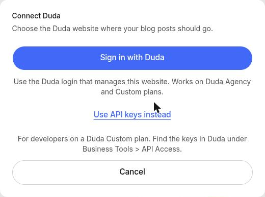
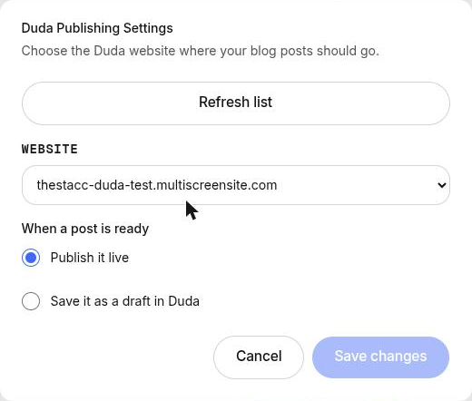
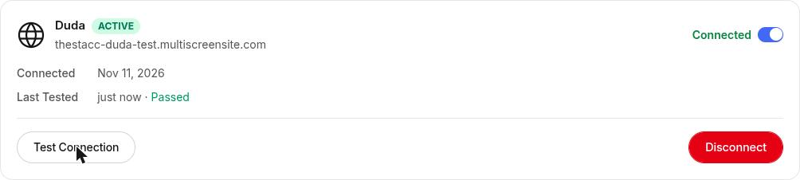

Use this if your website is built on Duda. theStacc publishes each article to your Duda blog with its title, text, images, SEO title, meta description and URL. You sign in with Duda once; there is no password to copy.

## What you need

- A login to the Duda account that manages the website. If an agency built your site, they have it.
- A Duda **Agency** or **Custom** plan. Not sure which plan? Ask whoever built your website.
- A blog on the site. If there is none, add a **Blog** page in the Duda editor first.

## Connect

1. In theStacc, open **Content SEO > Settings > Publishing**.
2. On the **Duda** card, click **Connect**, then **Sign in with Duda**.

<Frame caption="Sign in with the Duda login that manages this website.">
  
</Frame>

3. Sign in to Duda and allow theStacc. You come back to theStacc automatically.
4. Pick your website, then choose what happens when a post is ready: **Publish it live** or **Save it as a draft in Duda**. Click **Save changes**.

<Frame caption="Pick the website and choose live or draft.">
  
</Frame>

theStacc tests the connection straight away. When the card says **Connected**, you are done.

<Frame caption="Duda connected and tested.">
  
</Frame>

## Using API keys instead

Agencies on a Duda **Custom** plan can connect with API keys instead of signing in. In the connect window click **Use API keys instead**, then enter the **API username** and **API password** from Duda under **Business Tools > API Access**, choose the account region (US for most accounts), click **Find my websites** and pick the site.

## What theStacc publishes

Title, article text, images, tables, the featured image, SEO title, meta description, URL and author. Your posts appear on your Duda blog at `yoursite.com/post-url`.

## Good to know

- **Editing a published article:** Duda does not let apps change the text of a post that already exists. If you edit an article in theStacc after it is published, **Sync changes** updates the title, SEO fields, URL and tags, and tells you to update the text in Duda.
- **Signed out:** if you see *"Your Duda sign-in expired. Click Reconnect."*, click **Reconnect** on the Duda card and sign in again. Nothing is lost.
- **Only project admins** can connect, change or remove Duda.

## For sales and agencies

Ask the agency that manages the client's Duda site to click **Sign in with Duda** on the client's project, or to add you to their Duda account. Never ask for a Duda password.
