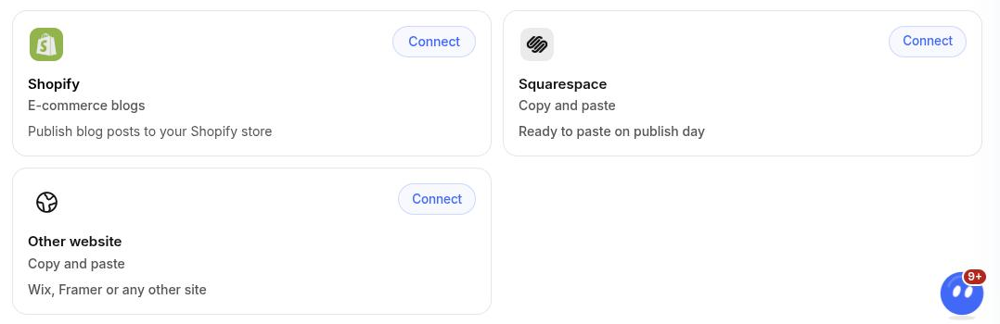
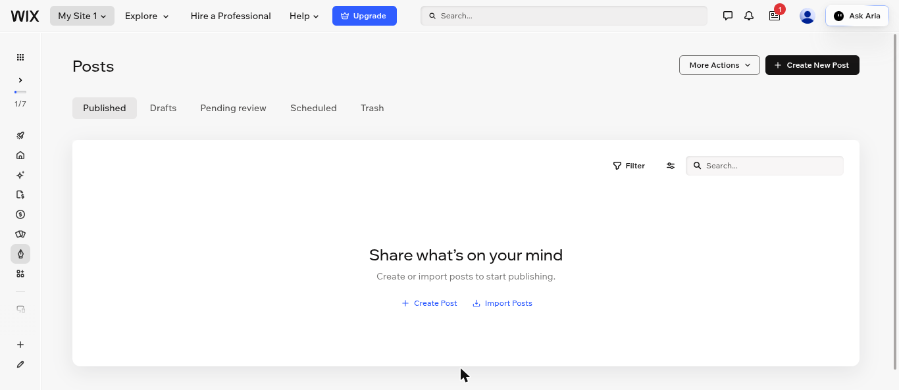
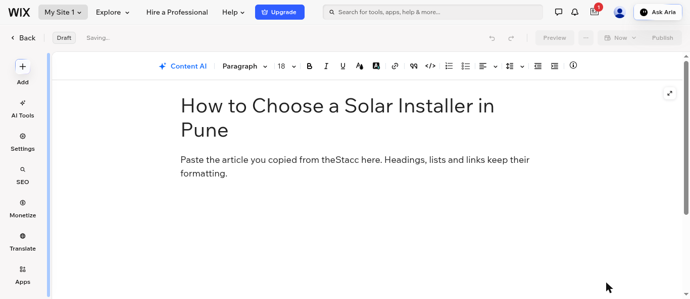
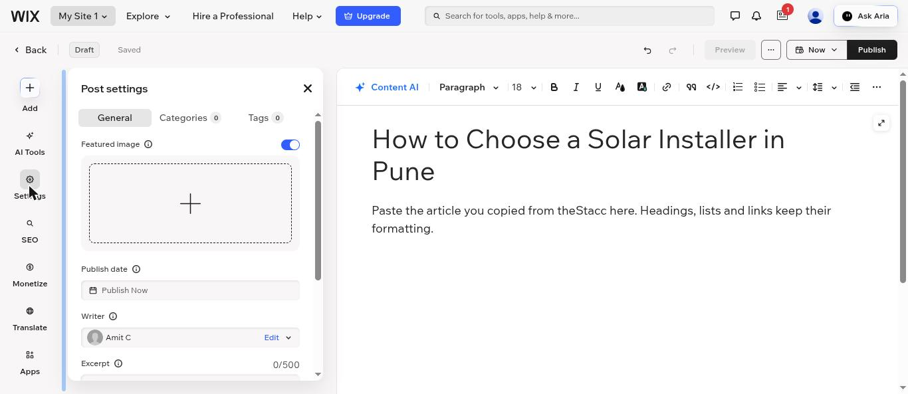
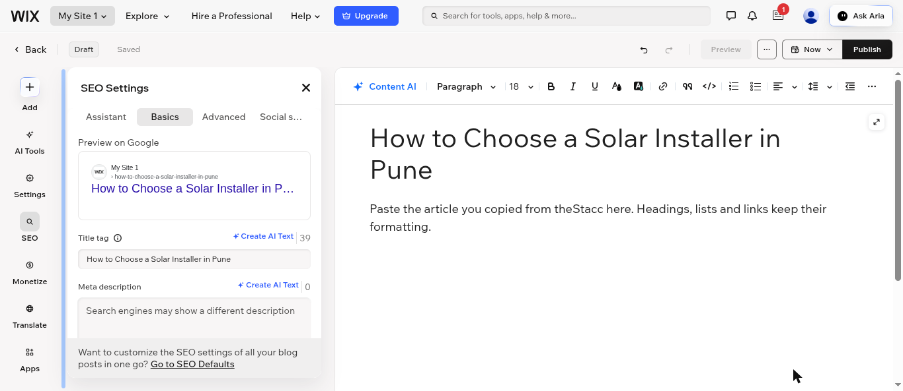
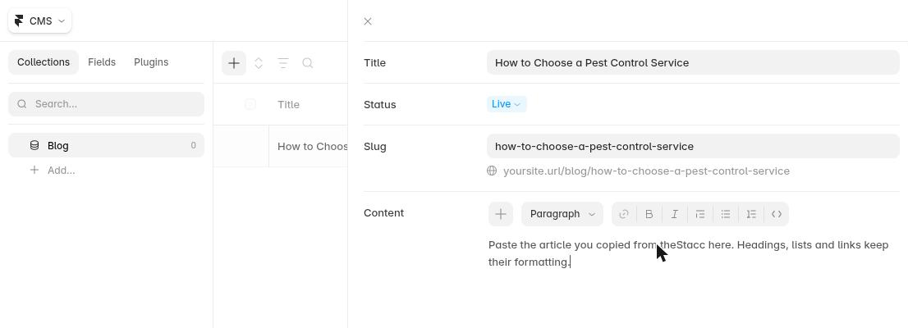

Use **Other website** when theStacc cannot post to your site for you: Wix, Framer, Hostinger Website Builder, GoDaddy Website Builder, a custom-built site, or anything not on the [list of destinations](/integrations/overview). On publish day theStacc gets each article ready to paste: one click copies the article, and every other field (image, SEO title, description, URL) has its own copy button. theStacc then marks the article live when it appears on your blog.

## What you need

- Your blog address, for example `https://www.yoursite.com/blog`. Open your blog in a browser and copy the address from the address bar.
- A login to your website editor that can create blog posts.

## Step 1: connect your website in theStacc (once)

1. In theStacc, open **Content SEO > Settings > Publishing**.
2. On the **Other website** card, click **Connect**, then **Enter blog address**.

<Frame caption="Other website is the copy and paste option for any site.">
  
</Frame>

3. Paste your blog address and click **Connect**.

theStacc then tells you one of two things:
- **"We found your blog feed"**: posts are marked live automatically when they appear on your blog.
- **"We could not find a feed for your blog"**: after you post an article, you confirm it by pasting its live address.

## Step 2: on publish day, post the article

On publish day theStacc emails you and the article turns **Ready to post**. Open it in theStacc and click **Post to your website**. The dialog has four steps, each with copy buttons: **Copy the article**, **Add the featured image**, **Fill in the SEO settings**, and **Publish it and confirm**. Keep it open next to your website editor.

The example below is Wix. Other editors use similar names.

### Copy the article

In the Wix dashboard, open **Blog > Posts** and click **Create New Post**.

<Frame caption="Wix: Blog > Posts > Create New Post.">
  
</Frame>

In theStacc, copy the **Post title** and paste it as the post title. Then click **Copy article** and paste it into the body. Headings, lists and links keep their formatting.

<Frame caption="Paste the title, then the article into the post body.">
  
</Frame>

### Add the featured image

In theStacc, click **Download image**. In Wix, click **Settings** on the left and upload it under **Featured image**. You can also paste the **Image alt text** from theStacc.

<Frame caption="Wix: Settings > Featured image.">
  
</Frame>

### Fill in the SEO settings

In Wix, click **SEO** on the left, then the **Basics** tab. Paste the **SEO title** into **Title tag**, the **SEO description** into **Meta description**, and the **URL slug** into **URL slug**.

<Frame caption="Wix: SEO > Basics > Title tag and Meta description.">
  
</Frame>

### Framer

Framer blog posts live in a **CMS collection** (usually called Blog). Switch the editor from **Canvas** to **CMS**, open your blog collection and click **+** to add an item. Paste the **Post title** into **Title**, the **URL slug** into **Slug**, and the article into **Content**.

<Frame caption="Framer: CMS > your Blog collection > + new item.">
  
</Frame>

For the featured image, upload it to the collection's image field. If your collection has none, add an **Image** field under **Fields**. Framer sets the SEO title and description on the blog page's settings, usually from collection fields, so add a field for the meta description if your template has one. Then click **Publish**.

### Other editors

In other editors (Hostinger, GoDaddy and so on) the same fields usually sit in the post's settings, often under a section called **SEO**. If you cannot find one, search your editor's help for "blog post SEO".

### Publish it and confirm

Publish the post in your editor. Back in theStacc:
- If theStacc found your blog feed, you are done: the article is marked live when it appears. You can also click **I've posted it** straight away.
- If not, paste the address of the live post into **Live post address** and click **I've posted it**.

If you decide not to post an article, click **Not posting this one**. It moves back to approved and is not posted.

## For sales and agencies

Ask the client for their blog address and connect **Other website** for them. The client never shares a website password with theStacc. Whoever posts the articles needs a login to the website editor, so either the client posts them or they add you as a collaborator in their editor with a role that can write blog posts.

If the client is on WordPress, Webflow, Shopify or Ghost, connect that instead: theStacc posts for them and nobody has to copy and paste.
