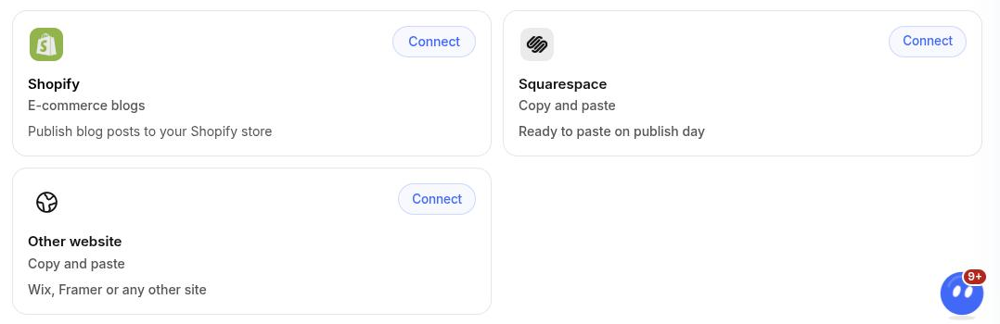
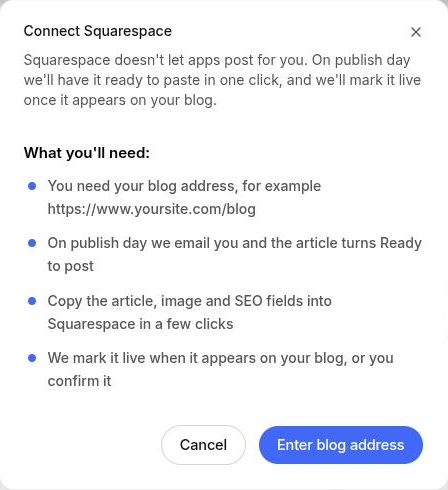
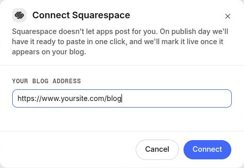
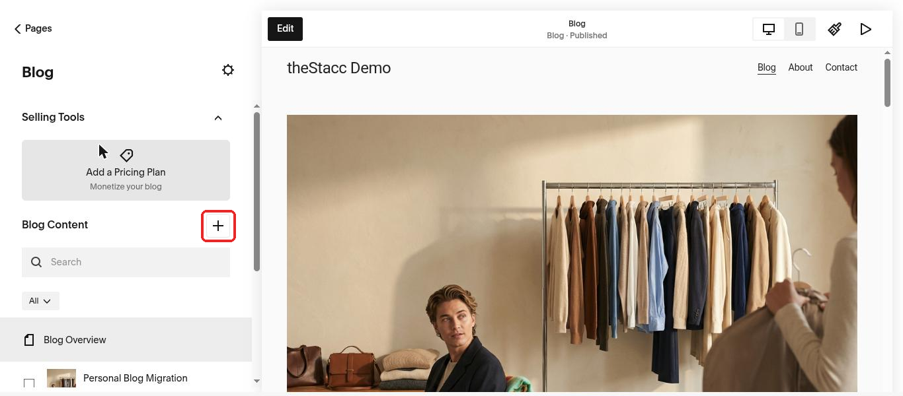
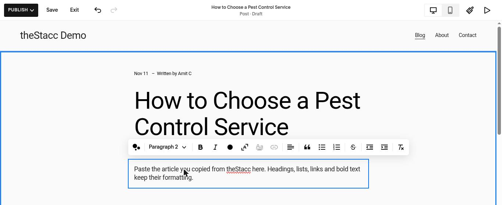
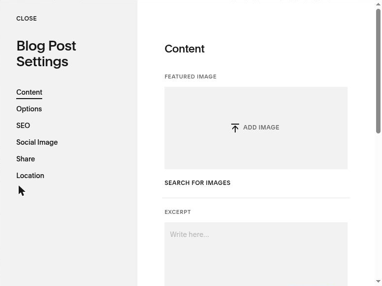
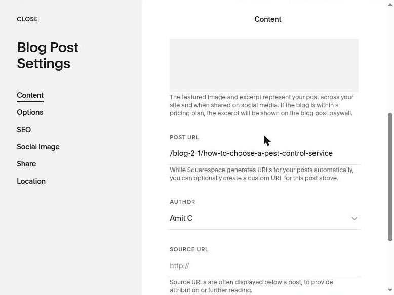
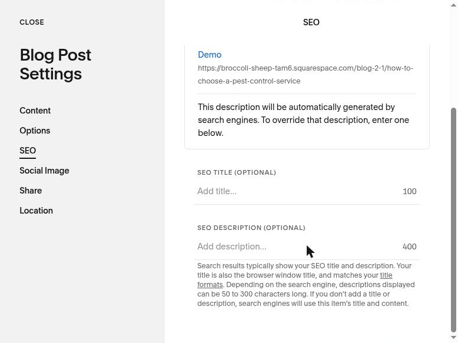

Squarespace does not let apps post to a blog for you, so theStacc cannot publish there on its own. Instead, on publish day theStacc gets each article ready to paste: one click copies the article, and every other field (image, SEO title, description, URL) has its own copy button. theStacc then marks the article live when it appears on your blog.

## What you need

- Your blog address, for example `https://www.yoursite.com/blog`. Open your blog in a browser and copy the address from the address bar.
- A Squarespace login that can edit the site's pages.
- A **Blog** page on your Squarespace site. If you do not have one: **Website > Pages > +** (next to Main Navigation) **> Blog**.

## Step 1: connect Squarespace in theStacc (once)

1. In theStacc, open **Content SEO > Settings > Publishing**.
2. On the **Squarespace** card, click **Connect**, then **Enter blog address**.

<Frame caption="The Squarespace and Other website cards are the copy and paste options.">
  
</Frame>

<Frame caption="Connect Squarespace: what happens on publish day.">
  
</Frame>

3. Paste your blog address and click **Connect**.

<Frame caption="Enter the address of your blog page, then click Connect.">
  
</Frame>

theStacc then tells you one of two things:
- **"We found your blog feed"**: posts are marked live automatically when they appear on your blog.
- **"We could not find a feed for your blog"**: after you post an article, you confirm it by pasting its live address.

## Step 2: on publish day, post the article

On publish day theStacc emails you and the article turns **Ready to post**. Open it in theStacc and click **Post to Squarespace**. The dialog has four steps, each with copy buttons. Keep it open next to Squarespace.

### Copy the article

In Squarespace, open **Website > Pages**, click your **Blog** page, then click **+** next to **Blog Content**.

<Frame caption="Open your Blog page and click + to start a new post.">
  
</Frame>

In theStacc, copy the **Post title** and paste it into **Enter a post title**. Then click **Copy article** and paste into **Write here...**. Headings, lists, links and bold text keep their formatting.

<Frame caption="Paste the title, then the article into the post body.">
  
</Frame>

Click **Save**, then **Exit**.

### Add the featured image

In theStacc, click **Download image**. In Squarespace, hover the post in the Blog list, click **...** then **Settings**. On the **Content** tab, click **Add Image** under **Featured Image** and upload it.

<Frame caption="Blog Post Settings > Content > Featured Image.">
  
</Frame>

### Fill in the SEO settings

Still in **Blog Post Settings**:
- **Content** tab, **Post URL**: paste the **URL slug** from theStacc after your blog path, for example `/blog/how-to-choose-a-pest-control-service`.

<Frame caption="Content tab > Post URL.">
  
</Frame>

- **SEO** tab: paste the **SEO title** into **SEO Title** and the **SEO description** into **SEO Description**.

<Frame caption="SEO tab > SEO Title and SEO Description.">
  
</Frame>

### Publish it and confirm

In Squarespace, open the post and click **Publish**. Back in theStacc:
- If theStacc found your blog feed, you are done: the article is marked live when it appears. You can also click **I've posted it** straight away.
- If not, paste the address of the live post into **Live post address** and click **I've posted it**.

If you decide not to post an article, click **Not posting this one**. It moves back to approved and is not posted.

## For sales and agencies

Ask the client for their blog address (for example `https://www.theirsite.com/blog`) and connect Squarespace for them. The client never shares a Squarespace password with theStacc. Whoever posts the articles needs a Squarespace login that can edit pages, so either the client posts them or they add you as a **Website Editor** contributor in Squarespace.
