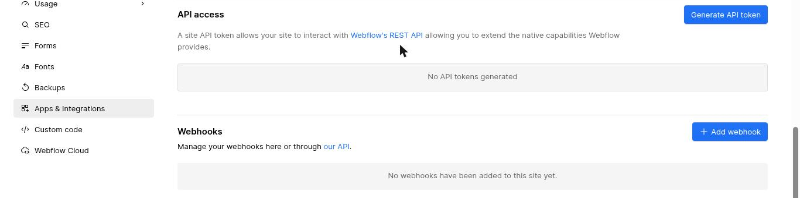
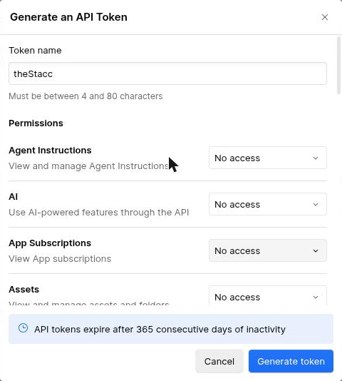
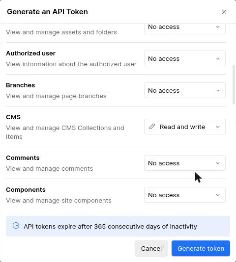
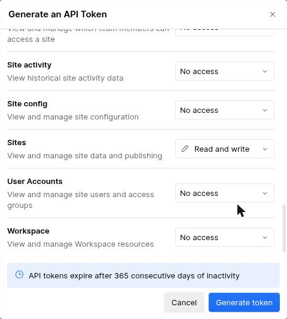
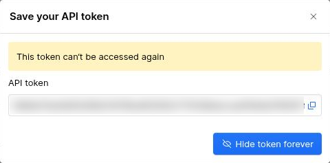
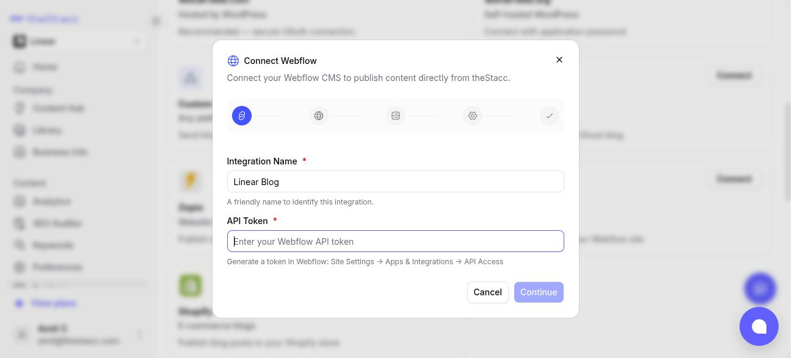

Publish blog content to your Webflow CMS collections via a Webflow API token.

## Before you start

- Your Webflow workspace must be on a plan that includes the CMS API (Workspace plans with CMS hosting). Free workspaces can read but cannot create CMS items.
- The Webflow site must have been **published at least once from the Designer**. Webflow rejects live CMS publishes if the site has never been published.
- A CMS Collection for blog posts must exist on the site. If you don't have one, create it in Webflow Designer → CMS → New Collection (recommended fields below).

## Step 1: generate a Webflow API token

1. In Webflow, open the site's **Site settings** and go to **Apps & Integrations**.
2. Scroll down to **API access** and click **Generate API token**.

<Frame caption="Site settings > Apps & Integrations > API access.">
  
</Frame>

3. Name the token `theStacc`.

<Frame caption="Name the token theStacc. Every permission starts at No access.">
  
</Frame>

4. Set exactly two permissions to **Read and write** and leave every other one on **No access**:

| Permission | Set to | Why |
|---|---|---|
| **CMS** | Read and write | Create and update blog items in your collection |
| **Sites** | Read and write | Read the site and re-publish it so new posts appear live |

<Frame caption="CMS: Read and write.">
  
</Frame>

<Frame caption="Sites: Read and write.">
  
</Frame>

5. Click **Generate token**, then copy it with the copy icon. Webflow shows it only once ("This token can't be accessed again"). If you lose it, generate a new one.

<Frame caption="Copy the token before closing this dialog.">
  
</Frame>

Webflow expires a token after 365 days without use. If publishing stops working after a long pause, generate a new token and paste it into theStacc.

## Step 2 — Connect in theStacc

1. In theStacc, open **Publishing** in the sidebar. Click **Connect** on the **Webflow** card, then **Configure Webflow**.
2. Enter an integration name and your API token, then click **Continue**.
<Frame caption="Connect webflow from the Publishing page.">
  
</Frame>

3. Select your Webflow site from the dropdown.
4. Select the CMS collection where blog posts should land.
5. Map theStacc fields to your Webflow collection fields:

- **Required:** Title, Content, Slug

- **Optional:** Featured Image, Meta Description, Excerpt, Tags, Author, Category, Published Date, Is Featured

- Auto-mapping fills most of these based on field-name matches — review and adjust.

1. Choose a publishing behavior:

- **Publish Immediately** — items go live the moment theStacc publishes them; theStacc also re-publishes the site so they appear on the live URL. This is the default for a new Webflow connection.

- **Save as Draft** — items appear in Webflow as drafts; you publish manually.

- **Stage for Review** — items are created and ready to publish; you press Publish in Webflow Designer.

1. Click **Create Integration**.

## Changing Webflow settings later (no token re-entry)

Open the connected Webflow integration's **Edit settings** to change the publishing behavior, the selected site or collection, or your field mappings — without re-pasting the API token. For security, theStacc masks the saved token and never shows it back to you, so the edit form simply leaves it untouched unless you deliberately paste a new one.

If you do paste a new token, theStacc validates it against Webflow before saving. A typo or a revoked token is rejected with a clear message (*"Webflow API token is invalid or expired…"* or *"…lacks required scopes (sites:read, cms:read, cms:write)"*) so a bad token can never silently replace your working one.

## Recommended CMS collection fields

| Field | Webflow type |
| --- | --- |
| Name | Plain text (auto-created — title goes here) |
| Slug | URL slug (auto-created) |
| Post Content | Rich text |
| Featured Image | Image |
| Excerpt | Plain text |
| Meta Title | Plain text |
| Meta Description | Plain text |
| Tags | Plain text (comma-separated) |
| Author | Plain text |

> Webflow blog templates often use **Reference / Multi-reference** fields for Categories, Tags, and Authors. theStacc cannot yet auto-create the referenced items, so use **Plain text** fields for these for now.

## Verify

After saving the integration, click **Test Connection**. A green check confirms the token works and the collection is reachable.

## Troubleshooting

- **"Invalid API token"** — token wrong, expired, or revoked. Generate a new one and update the integration.
- **"No CMS collections found"** — the site has no CMS collections. Create one in Designer first.
- **"Item with this slug already exists"** — a post with that slug was already published. Edit the slug or delete the existing item in Webflow.
- **Post published but URL returns 404** — most often the site has never been published from the Designer, or you're using a custom domain whose DNS hasn't propagated. Open Webflow Designer and click Publish at least once.
- **"409 Site not published" on first publish** — Webflow rejects live CMS publishes on un-published sites. theStacc automatically falls back to staged item creation. Publish your site once in Designer; future live publishes work directly.
- **403 Forbidden when creating items** — the workspace plan doesn't include CMS API access. Upgrade to a Workspace plan with CMS hosting.

## What gets sent to Webflow

theStacc sends `POST https://api.webflow.com/v2/collections/{id}/items/live` (or `/items` for staged) with your mapped fields plus the required `name` and `slug`. No source code, design changes, or custom integrations are needed on the Webflow side.
