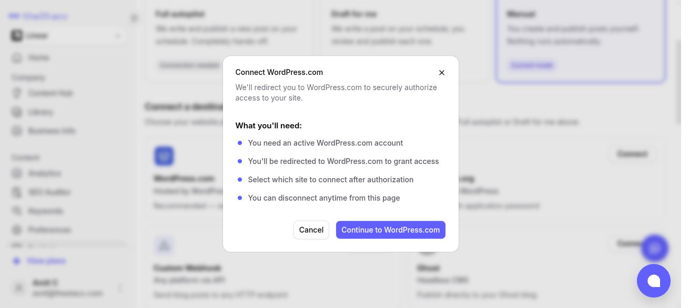
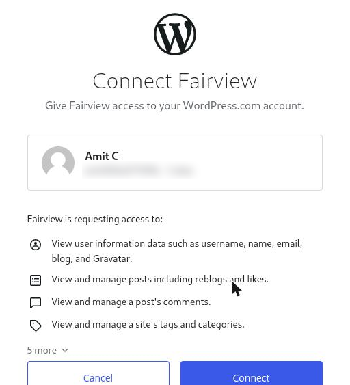

Use this if your site is hosted on WordPress.com (the address often ends in `.wordpress.com`, or you manage it at wordpress.com). If your site runs its own WordPress, use [WordPress.org](/integrations/wordpress-org) instead.

There is no password to copy: you sign in to WordPress.com and click **Connect**.

## What you need

- A WordPress.com account that can publish posts on the site (Administrator or Editor).

## Connect

<Frame caption="The WordPress.com connection in theStacc.">
  
</Frame>

1. In theStacc, open **Content SEO > Settings > Publishing**.
2. On the **WordPress.com** card, click **Connect**, then **Continue to WordPress.com**.
3. Sign in to WordPress.com. You see a **Connect Fairview** screen (Fairview is the company behind theStacc). Check the account shown is the one that owns your site, then click **Connect**.

<Frame caption="WordPress.com asks you to connect Fairview, the company behind theStacc. Click Connect.">
  
</Frame>

4. If your account has more than one site, pick the site to publish to.

## What theStacc publishes

Title, article, featured image (with alt text), categories, tags, excerpt and URL slug. WordPress.com does not let apps set an SEO plugin's title or meta description, so those are not sent.

## If it stops working

If you see *"WordPress.com token expired or invalid. Please reconnect your account."*, click **Connect** in theStacc again and connect once more.

## For sales and agencies

Ask the client to click **Connect** themselves, or to add you to their WordPress.com site as an **Editor** so you can connect it. Never ask for their WordPress.com password.
