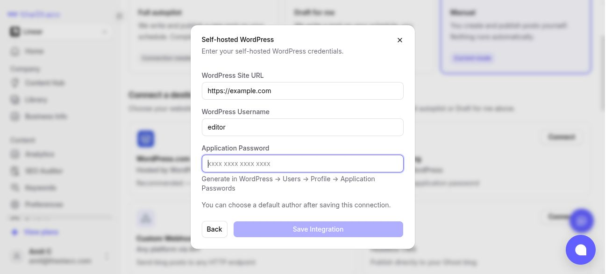

Use this if your site runs its own WordPress (hosted on Hostinger, GoDaddy, Bluehost, SiteGround, your own server and so on). If your site is on WordPress.com, use [WordPress.com](/integrations/wordpress-com) instead.

You never share your WordPress login password. You create an **Application Password**: a separate password WordPress makes for apps like theStacc, which you can cancel at any time.

## What you need

| Field in theStacc | Where to find it |
|---|---|
| **WordPress Site URL** | Your website address, for example `https://example.com` |
| **WordPress Username** | The username you log in to WordPress with. Not your display name and not your email. |
| **Application Password** | Made in WordPress in Step 2 below |

**Before you start:**
- You can log in to your WordPress admin (`https://yoursite.com/wp-admin`).
- The account is an **Administrator**, **Editor** or **Author**. We recommend **Editor**.
- Your site uses `https://`.

## Step 1 (recommended): create a user for theStacc

You can use your own account, but a separate user is safer: you can remove it any time without changing your own password, and nobody has to share the admin password.

1. In WordPress admin, go to **Users > Add New User**.
2. Enter a username (for example `thestacc`) and an email address you can receive.
3. Set **Role** to **Editor**.
4. Click **Add New User**.

[Screenshots of the Add New User screen and the Role options](https://yoast.com/user-roles-in-wordpress/)

## Step 2: create the Application Password

1. Log in to WordPress as the user from Step 1 (or your own account).
2. Go to **Users > Profile**.
3. Scroll down to **Application Passwords**.
4. Type `theStacc` as the name and click **Add New Application Password**.
5. Copy the password WordPress shows, for example `abcd 1234 efgh 5678 ijkl 9012`. WordPress shows it only once.

## Step 3: connect in theStacc

<Frame caption="The WordPress.org connection in theStacc.">
  
</Frame>

1. In theStacc, open **Content SEO > Settings > Publishing**.
2. On the **WordPress.org** card, click **Connect**, then **Enter Credentials**.
3. Enter the **WordPress Site URL**, the **WordPress Username** and the **Application Password**. You can paste the password with or without its spaces.
4. Click save. theStacc tests the connection straight away and tells you if anything is wrong.

After connecting you can pick the **default author** your posts appear under.

## What theStacc publishes

Title, article, featured image (with alt text), categories, tags, excerpt and URL slug. If you use the **Yoast SEO** plugin, the SEO title and meta description are filled in too.

## If it does not connect

| What you see | What to do |
|---|---|
| "This looks like a regular WordPress password" | You pasted your login password. Create an Application Password in Step 2 and paste that. |
| No **Application Passwords** section under Users > Profile | A security plugin may have turned it off. In **Wordfence**, go to **All Options** and untick **Disable WordPress application passwords**, then save. Other security plugins can turn it off too; look for an "application passwords" setting. Also check the site uses `https://`. |
| "Authentication failed" | Check the username is the login username, not the display name, and that the Application Password belongs to that same user. |
| "...has the role ... which cannot create posts" | Change the user's role to **Editor** (or Author) under **Users**. |
| "WordPress REST API not found" or "is blocked" | Check the site URL is correct. If it is, a security plugin or your host is blocking `yoursite.com/wp-json`; ask your host or developer to allow it. |
| "Could not connect to ..." | The site address is wrong or the site is down. Open it in your browser to check. |

## For sales and agencies: what to ask the client

Send the client this, and never ask for their admin password:

> Please create a WordPress user for theStacc with the **Editor** role, then log in as that user and create an **Application Password** named "theStacc" (Users > Profile > Application Passwords). Send us your **site URL**, that user's **username**, and the **Application Password**.

To disconnect later, the client deletes the Application Password or the user in WordPress.
